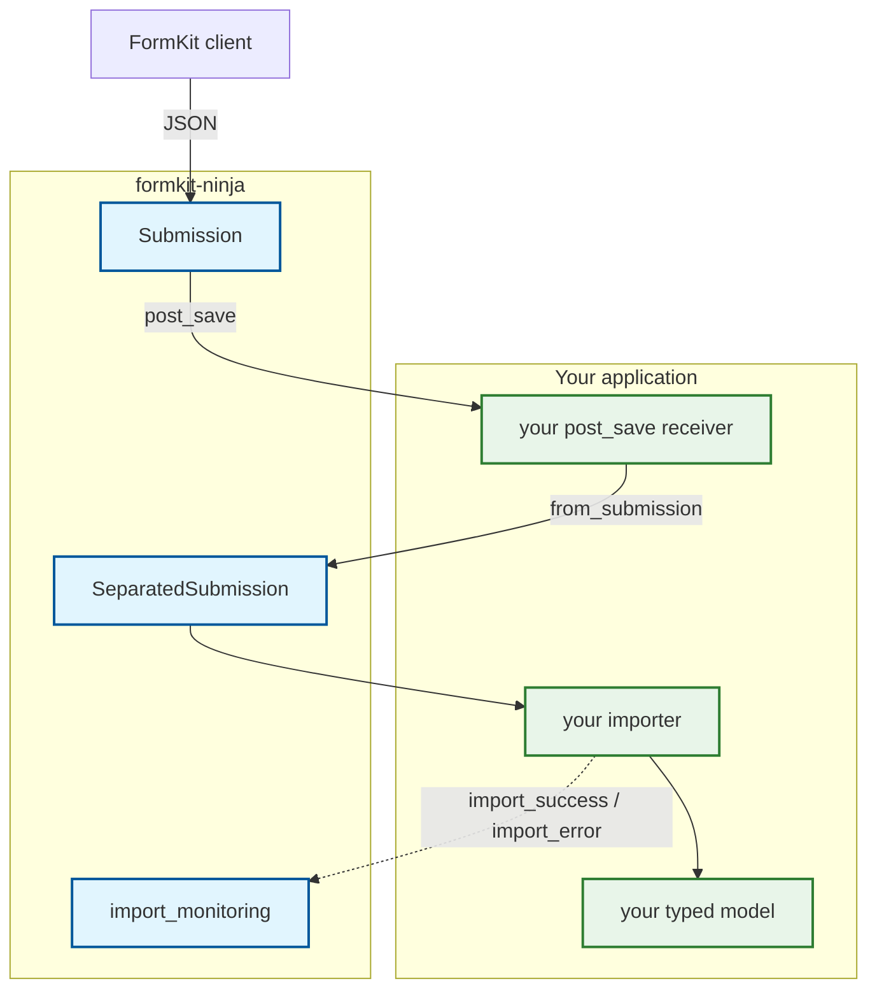

# Submission Architecture

How a submitted document becomes rows, and where an application hooks into that.

## Concept

`formkit-ninja` separates **storing** a submission from **deriving** anything out of it.
A `Submission` row is the canonical document: it is saved first, saved whole, and saved
even if everything downstream fails. Deriving `SeparatedSubmission` rows from it, and
populating an application's own typed tables from those, happen afterwards and are the
application's call.

This is what makes the split safe to re-run, and what lets an application decide *when*
it happens — inline, in a task queue, or in a management command.



Everything inside the library box is provided. Everything in the application box is
yours to write — including the arrow that starts the split.

---

## Wiring the split

`Submission.save()` does **not** derive `SeparatedSubmission` rows. Nothing derives them
until you connect a receiver:

```python
# yourapp/signals.py
from django.db.models.signals import post_save
from django.dispatch import receiver

from formkit_ninja.form_submission.models import SeparatedSubmission, Submission


@receiver(post_save, sender=Submission)
def split_submission(sender, instance, **kwargs):
    SeparatedSubmission.objects.from_submission(instance)
```

Connect it from your `AppConfig.ready()` — importing the module is enough — so it is live
for every save path: API, admin, shell and management commands.

**Why the library does not do this itself.** It used to, from inside `save()` and *after*
`post_save` had already fired. An application running its own split from a `post_save`
receiver — the arrangement documented here — therefore split every submission twice, and
any work it did after its own split could be undone by the library's second pass. See
issue #57.

Two consequences worth knowing:

- **Nothing splits until you wire it.** A submission saved with no receiver connected is
  stored correctly but has no derived rows, and the derived-model endpoints will show
  nothing for it. There is no error and no warning; the tables are simply empty.
- **Orphan reconciliation rides on the split.** `from_submission()` sweeps rows that no
  longer exist in the canonical fields, so that self-healing only runs as often as your
  receiver does. The `reconcile_separated_submissions` management command is the
  out-of-band sweep.

---

## Recording import outcomes

The library declares two signals and records what they carry. It does not send them —
**your importer does**, because only your code knows whether populating your model
succeeded.

| Signal | You send it when | Arguments |
|---|---|---|
| `import_success` | Your importer populated a typed model from a `SeparatedSubmission`. | `sender`, `instance`, `model_instance`, `was_created` |
| `import_error` | Your importer raised while doing so. | `sender`, `instance`, `error` |

They live in `formkit_ninja.form_submission.signals`. `import_monitoring` receives both
and writes a `SeparatedSubmissionImport` row, which is what
`SeparatedSubmission.objects.with_import_failure()` and the admin's import-status columns
read.

```python
# yourapp/importer.py
from formkit_ninja.form_submission import signals as formkit_signals


def import_row(separated_submission):
    try:
        model_instance, was_created = populate_my_model(separated_submission)
    except Exception as exc:
        formkit_signals.import_error.send(
            sender=separated_submission.__class__,
            instance=separated_submission,
            error=exc,
        )
        raise
    formkit_signals.import_success.send(
        sender=separated_submission.__class__,
        instance=separated_submission,
        model_instance=model_instance,
        was_created=was_created,
    )
```

Sending them is optional. Skip it and the split still works; you just lose the
import-status surface.

---

## Populating your own models

The library has no hydration method. It deliberately does not know the shape of your
tables, so mapping a `SeparatedSubmission` onto your model is code you write — typically
in the receiver that reacts to the row being created, calling your importer as above.

The generated code from `generate_code` gives your models a `submission` one-to-one link
back to `SeparatedSubmission`, which is the anchor to populate against:

```python
submission = models.OneToOneField(
    "formkit_ninja.SeparatedSubmission",
    on_delete=models.CASCADE,
    primary_key=True,
    related_name="+",
)
```

Keying on that link is what keeps your typed table and the generic table in step: one row
each, sharing a primary key, so re-running the split updates rather than duplicates.

---

## Decomposition, in three stages

### Stage 1 — Flatten

The JSON document is walked recursively. Every group and repeating section is given a
stable UUID if it does not already carry one.

- **In**: the nested document.
- **Out**: a flat sequence of rows, each knowing its path, its identity, its answers and
  its position.

### Stage 2 — Normalise

Those rows are written as `SeparatedSubmission` records: one root row where
`repeater_key` is null, and one row per repeat, each pointing at its parent through
`repeater_parent`.

Identity comes from the document, never minted here — which is what lets the same
document replay to the same primary keys years later.

### Stage 3 — Populate

Your importer turns each row into a row of your own, as above.

The same decomposition is also available as frozen values that touch no database, through
`emit_submission`, for appending to a durable log. `from_submission` walks the same
emissions, so there is one decomposition rather than two that could drift.

---

## Re-processing by hand

```python
from formkit_ninja.form_submission.models import SeparatedSubmission, Submission


def reprocess_all():
    for submission in Submission.objects.all():
        rows = SeparatedSubmission.objects.from_submission(submission, force=True)
        print(f"{submission.pk}: {len(rows)} rows")
```

`from_submission` is idempotent on identity — re-running it updates the same rows rather
than creating new ones — and sweeps rows the document no longer contains.

**`force=True` is what makes re-processing do anything.** By default the split is
change-aware: a derived row whose computed values are identical to what is already stored
is not re-saved, so no `post_save` fires for it and no downstream work runs. That is the
behaviour you want on an ordinary save, and exactly the wrong one here — re-processing an
unchanged document without `force` walks every submission and fires nothing. Pass it when
you are rebuilding, and leave it off in the receiver that reacts to a live edit.

---

## Recording what changed

`Submission.save()`, `Submission.delete()` and `Submission.objects.filter(...).delete()` record what
changed as events, in the same transaction as the write: `submission:create` (every answer),
`submission:edit` (only the answers that changed; for a repeater whose rows all carry a `uuid`, only
the rows added, removed, moved or edited), `submission:status`, `submission:remove` /
`submission:restore` (`is_active`), and `submission:delete`. `form_submission.events.fold` replays
them back into the submission exactly, so the submission as each save left it can be rebuilt from
them, as long as every write to it was recorded (below).

A save made from inside another save of the same submission, such as a `post_save` receiver that
changes an answer and calls `instance.save()`, records nothing itself: the outer save reads the row
back after its receivers have run and records the change from before it to the final row once, with
the normalisations of both saves. A receiver that deletes the submission it was called for is
handled the same way, so the outer save records the delete. A receiver that saves or deletes a
different submission records it as usual.

Every event carries `event_format`, the version of the event's own shape (`EVENT_FORMAT`, now 1),
which is separate from `schema_version`, the form's version. `fold` reads every format this library
has shipped (`READABLE_EVENT_FORMATS`) and refuses an event in any other, or with none, naming the
format and the event id. The state `fold` returns carries `schema_version`, from the last event that
has one; it is not a column of the row, so `==` leaves it out and `fold(events) == SubmissionState.of(row)`
holds whatever version the events were recorded against. `fold_versions(events)` returns one `(event, state)` pair per event,
for a history reader: it walks every event, including the ones before a `submission:reset`, and
its last state is `fold(events)`. Before a reset, an event that cannot be applied (an edit recorded
after a bulk load, say) and every event after it up to the reset are paired with `STATE_UNKNOWN`,
which a reader can tell apart from `None`, the state after a delete. It accepts exactly the
histories `fold` accepts.

They go to the class named in `FORMKIT_NINJA_SUBMISSION_EVENT_SINK`, or by default to the
append-only `SubmissionEventRecord` table (a trigger refuses `UPDATE` and `DELETE`; trimming or erasing history runs inside `pgtrigger.ignore("formkit_ninja.SubmissionEventRecord:append_only")`). **On upgrade, leaving the setting unset means every save
that changes a submission writes to that table**, alongside the existing history; set it to
`"formkit_ninja.form_submission.sinks.NullSink"` to record nothing. Wrap a request in `form_submission.events.context(actor=...,
reason=..., via=...)` to say who and why.

### Writes that record nothing

`save()` and `delete()` on an instance, and `delete()` on a `Submission` queryset (which the admin's
"delete selected" uses), record events. A queryset delete records one `submission:delete` per row,
with the current context, all sharing one `correlation`. These writes record nothing:

| Write | What the history then gets wrong |
|---|---|
| `bulk_create` | there is no create, so the first recorded event is an edit and `fold` refuses it |
| `QuerySet.update()`, `bulk_update` | the change is missing; `fold` returns the state without it and no error, unless a later edit names repeater rows the fold never saw, when it raises |
| deleting a user (the owner foreign key is `SET_NULL`) | the fold still shows the old owner |
| raw SQL | anything it changed |

So an error from `fold` is not how an unrecorded write shows. Find one by comparing
`fold(events)` with `SubmissionState.of(row)` for the submission; where they differ, call
`form_submission.sinks.record_reset(submission)`. After a bulk write you know about, call it for
each submission the write touched. It records `submission:reset`, the whole stored state, and `fold` takes the last reset as
its starting point, so the fold matches the row again. The same event starts a backfilled history
that begins part-way through a submission's life. `save()` cannot notice the gap itself: it never
reads the history back, and reading it on every save would cost more than the write. A deletion
cannot be repaired this way, since there is no row left to record; delete through
`Submission.delete()` or a queryset's `delete()`, never raw SQL, when the history matters.

Each event carries `schema_version`, the form's version when that event was recorded, including a
status change or an edit that carries one answer. The answers an event does not carry were recorded
by whichever earlier event carried them, under that event's version. Values are recorded as the
database stored them.

When Django saves an instance whose row is gone (it tries an update, finds no row, and inserts),
the answers' `pre_save` runs twice and so does the normaliser; the create lists the normalisations
of both runs, each once.

To store answers in one form — say, an option's value as a number rather than text — name a
normaliser in `FORMKIT_NINJA_SUBMISSION_NORMALISER`: a function `(form_type, fields) -> Normalised`
from `form_submission.normalise`. It runs on every save that writes the answers, before the write;
the stored answers and the events hold what it returns, and the create or edit lists each answer it
changed with the rule that changed it (`normalised`). A replay reads the recorded result and never
runs the normaliser again, so the normaliser may consult the application's own tables.

## See also

- [What is public](public-api.md) — which of these names you may rely on, and at what tier.
- `okf/concepts/submission-decomposition.md` — the same ground, written for agents.
